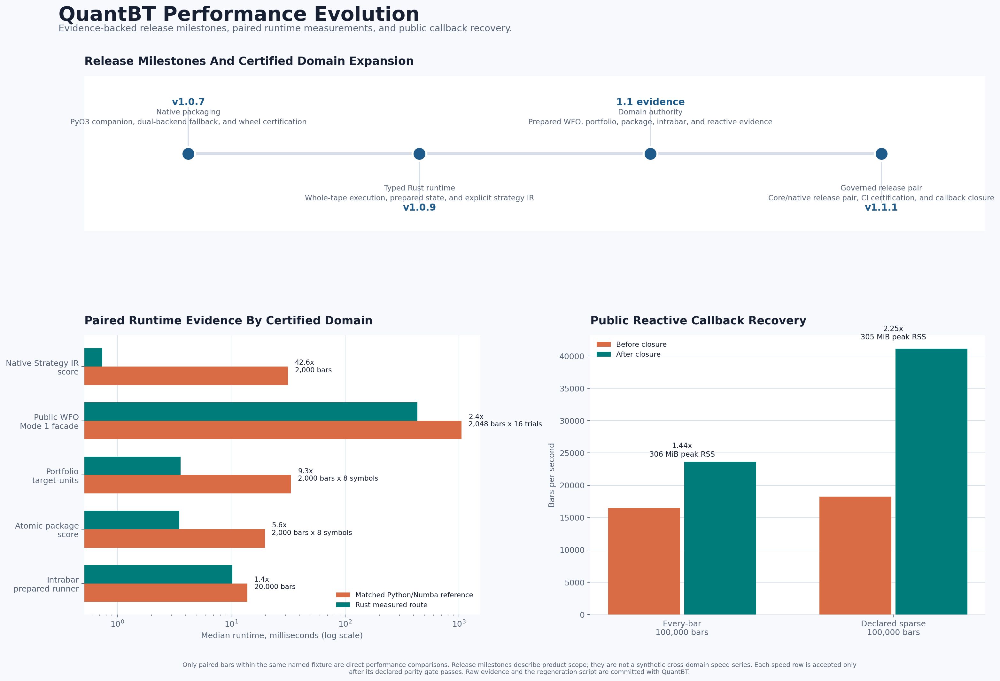

# QuantBT

[](https://pypi.org/project/quantbt-engine/)
[](https://pypi.org/project/quantbt-engine/)
[](https://github.com/BobbyAxerol/quantbt/actions/workflows/ci.yml)
[](https://pypi.org/project/quantbt-native/)
[](LICENSE)

QuantBT is a transparent backtesting engine for systematic research,
event-driven execution, multi-symbol portfolios, arbitrage, options, and
walk-forward validation.

The public API stays Pythonic. NumPy and Numba power portable research paths,
while a governed Rust/PyO3 companion accelerates certified event workloads.
Completed research/audit runs use the shared result/report surface. Explicit
score/compact profiles retain only their documented outputs, not full audit data.

```python
from quantbt import QuantBTEndpoint
```

## Install

```bash
pip install --upgrade quantbt-engine
# or
poetry add quantbt-engine
```

The distribution name is **`quantbt-engine`**; the import name is
**`quantbt`**.

On Linux x86_64 with glibc and CPython 3.11-3.13, installation also resolves
the exact pre-built **`quantbt-native`** companion. Users do not need Cargo,
Rust, Maturin, a second import, or a different endpoint. Portable Python/Numba
routes remain available where their dependencies are supported; explicit Rust
contracts still require a matching native wheel. Alpine/musl is not covered:
the dependency marker cannot distinguish musl from glibc, so installation may
fail there rather than automatically fall back.

Prepared next release pair (not yet published):

| Distribution | Version | Purpose |
|---|---:|---|
| `quantbt-engine` | `1.2.0` | Public API, Python/Numba engines, reports, compatibility oracle |
| `quantbt-native` | `0.4.3` | Internal PyO3 extension, including default QMS numerics and prepared witnesses |

The published `1.1.1 / 0.4.2` pair remains separate from this preparation.
QMS is opt-in: enabling its compiled capability does not enable meta selection
or change an existing endpoint/account policy. See the
[QMS release handoff](docs/meta_selection/RELEASE_HANDOFF.md) for exact artifact,
installed-W3 and public-consumer gates and the owner-controlled release order.
The [M5-12 preparation checklist](docs/mode5/M5_12_PREPARATION.md) retains the
earlier1.1.2candidate qualification. The owner has retargeted the next core
release to1.2.0, with native0.4.3; new source/artifact qualification is recorded
separately from old receipts and later platform/public-index proof.
The [prepared capability map](#prepared-release-capabilities) below describes
the candidate source, not what an ordinary install command already provides.
M5-12 records final-source local artifact qualification separately from
historical installed receipts, platform certification and public-index proof.
Local qualification does not authorize publication.

Optional features:

```bash
pip install "quantbt-engine[optimization,viz,reports]"
pip install "quantbt-engine[validation]"  # NautilusTrader, Python 3.12+
```

Walk-forward parameter search requires the `optimization` extra.

Verify the installed pair:

```python
from importlib.metadata import PackageNotFoundError, version

print("core:", version("quantbt-engine"))
try:
    print("native:", version("quantbt-native"))
except PackageNotFoundError:
    print("native: unavailable; use a supported portable route or install the exact companion")
```

Read the [native installation matrix](docs/native/install.md) for supported
platforms, backend controls, and troubleshooting.

## Optional Reporting V1

Completed endpoint/result `full_report()`, `show_metrics()` and `quick_plot()`
accept `reporting=ReportingRequest(...)` for explicit account-period, execution,
closed-trade/action and drawdown-episode reporting. This reporting opt-in does
not change execution or the WFO/meta objective. Separate account correctness
fixes in this candidate can change results; see the migration notice below.
The four populations stay separate: `account_period`, `execution`,
`closed_trade` and `closed_action`. Returns/drawdowns are numeric fractions
(percentages are display-only); PnL/costs retain their currency, durations their
declared units, and each metric its sample count, coverage and validity.
Declare the baseline, clock, sampling and annual periods explicitly.
Missing outcome attribution is metric-specific N/A with a reason, not a guessed
trade count or zero. Undefined bankruptcy-period ratios and invalid overflow
remain null with status; no-loss ratios are not JSON Infinity. Legacy scientific
metrics and `tearsheet()` keep their separate contracts. Read the
[reporting guide](docs/metrics/PUBLIC_REPORTING.md),
[metric definitions and units](docs/metrics/REPORTING_CONTRACT_V1.md) and runnable
[synthetic example](examples/reporting_metrics_v1.py).

Measured local CPython 3.12 reporting cost, one thread, one warmup/five samples:
the opt-in workload includes immutable snapshot/hash, reduction, episode detail
and grouped dictionary adaptation; it does not time strategy/execution.

| Account observations | Python full report p50 / p95 | Explicit Numba p50 / p95 | Numba observations/s | Worker peak RSS Python / Numba |
|---:|---:|---:|---:|---:|
| 2,000 | 6.435 / 6.828 ms | 1.728 / 1.826 ms | 1.16M | 202.11 / 300.85 MiB |
| 100,000 | 206.818 / 225.768 ms | 21.284 / 22.589 ms | 4.70M | 168.77 / 266.43 MiB |
| 1,000,000 | 2.111 / 2.165 s | 183.730 / 186.878 ms | 5.44M | 286.52 / 373.12 MiB |

These are **new report definitions and requested extra work**, not comparable
to the shorter legacy scientific metric set as a speedup. Text formatting was
0.05-0.10 ms in the original qualification. Public requests prepare the immutable
mask once; request preparation, snapshot/hash and serialization are measured
separately, not advertised as free.
First-call Numba account compilation/reduction took 5.30-5.80 s and is not in
the warm table. Python remains the reporting default; small ledgers may be
faster without compilation. Peak RSS includes the import/JIT floor, and the
2k row also draws the optional plot, so rows are not memory-scaling forecasts.
Public cache hits still rehash mutable input and adapt output. Full matched
legacy/new timings, coverage, caveats and local artifact receipts are in the
[copy/cost qualification](docs/metrics/MET03_COPY_COST_REPORT.md), with
historical evidence in the [performance follow-up](docs/metrics/MET03_PERFORMANCE_REPORT.md)
and [MET-03 report](docs/metrics/MET03_REPORT.md). No universal
1-10 ms promise or Rust Reporting V1 reducer is claimed.

Alternating same-process comparisons, two warmups/30 samples, exact full-output
hashes: against immediate parent `dc12427`, Python 2k account reporting is
**8.270 -> 6.335 ms**, 1M is **3.165 -> 2.081 s**, and 2k closed trades are
**15.491 -> 11.592 ms**. Against historical `24ad469`, Numba 1M is
**319.356 -> 164.557 ms**. This paired cold-adapter/reducer comparison is
separate from the full public/fresh-worker table above. Numba p95 and small
cells are not uniformly better; all measurements remain visible. Copy/deepcopy
and trusted pickle round trips retain validated readonly snapshots and rederive
identities; cache correctness does not depend on trusting serialized hashes.

## Quick Start

```python
from quantbt import QuantBTEndpoint

bt = QuantBTEndpoint.signal_notional(
    initial_capital=20_000,
    leverage=5,
    alloc_per_trade=10_000,
    fee_rate=0.0005,   # canonical one-way fee per fill
    slippage_bps=1.0,
    use_funding=False,
)

result = bt.backtest(
    data=df,                    # DatetimeIndex + OHLCV
    signal_col="pos_weight",   # target signal, e.g. -1.0 / 0.0 / 1.0
    symbols=["ETHUSDT"],
)

result.show_metrics()
result.quick_plot()  # requires: pip install "quantbt-engine[viz]"
```

`initial_capital` is equity/initial margin. Leverage defines buying power;
it does not multiply `alloc_per_trade`. `fee_rate` is always one-way. Legacy
`fee` remains accepted and is converted at the compatibility boundary.

## Choose An Endpoint

`QuantBTEndpoint` is the stable integration surface for notebooks and
services. Pick the route from the behavior the strategy needs, not from the
implementation language.

| Research need | Factory | Primary input | Default execution authority |
|---|---|---|---|
| Equity-relative single-symbol signals | `pct_equity(...)` | signal series | legacy-compatible Python |
| Fast fixed-notional signals | `signal_notional(...)` | signal series | native vectorized / Numba |
| Causal SL/TP/trailing | `intrabar_bracket(...)` | intent tape or columns | native intrabar / Numba |
| Explicit Rust intrabar bracket | `intrabar_bracket_rust(...)` | one-symbol `IntrabarIntentTape` | typed whole-tape Rust, explicit-only |
| Explicit fill/funding accounting audit | `fill_replay(accounting_backend="rust_v2")` | typed fill + funding tapes | Rust linear account authority |
| Stateful event strategy (default) | `event_driven(input_mode="strategy")` | strategy protocol | Python callback engine |
| Numeric every-bar reactive strategy (explicit) | `native_event_strategy(..., reactive_runtime="numeric_every_bar_v1")` | numeric context + primitive command writer | Rust simulation/accounting; Python decision |
| Stateful reactive WFO (explicit) | `endpoint.prepare_reactive_walk_forward(...)` | prepared R1/R2/R3 strategy factory | Rust account scoring with reset-flat fold accounts; Python decision |
| Canonical command tape | `event_driven(input_mode="orders")` | `OrderCommand` tape | auto: Python; Rust remains explicit and capability-gated |
| Legacy explicit orders | `orders(...)` | `OrderIntent` list | native event |
| Structural DCA/grid levels | `dca_ladder(...)` | ladder signal + OHLC | compatibility engine |
| Multi-symbol portfolio | `portfolio(...)` | target matrix | native portfolio / Numba |
| Pair or basket package | `basket(...)` | `BasketSpec` | native event package |
| Basis, stat-arb, carry, funding | `arbitrage(...)` | arbitrage spec | native event package |
| Option strategy/package | `options(...)` | option spec + market data | native option engine |
| Walk-forward optimization | `walk_forward(...)` | strategy + parameter space | WFO orchestration; opt-in prepared Rust scorer for certified scalar targets |
| One train/test holdout | `train_test_split(...)` | strategy + parameter space | WFO scoring stack; inherits eligible prepared Rust scoring |
| Third-party execution validation | `nautilus_validation(...)` | signal/data | NautilusTrader |

The full parameter, data, result, and support contracts are in the
[endpoint guide](docs/endpoint.md). For a decision tree, read
[backend selection](docs/backend_selection.md).

## Prepared Release Capabilities

For the prepared **1.2.0 / 0.4.3** pair, choose each research extension
explicitly. Installing compiled capabilities does not enable meta, choose a
sampler/selector, route a strategy or promote a default. Software support,
registered economic findings and final installed/release certification are
separate claims.

| Research need | Capability and reading path |
|---|---|
| Choose search independently of meta | [Four shared sampler recipes](docs/meta_selection/SAMPLERS.md), [optional numeric-space helper](docs/meta_selection/SAMPLER_SPACE_HELPER.md), [synthetic example](examples/wfo_sampler_space.py) |
| Learn from permitted historical tasks | [Meta off/shadow/active](docs/meta_selection/USAGE.md), [route bounds](docs/meta_selection/CURRENT_ROUTE_REVIEW.md), [nested scalar Mode 1](docs/meta_selection/NESTED_MODE1.md) |
| Inspect evidence before/after search | [Shared alpha diagnostics](docs/diagnostics/SHARED_ALPHA_DIAGNOSTICS.md), [pre-search researcher view](docs/diagnostics/PRESEARCH_RESEARCHER_REPORT.md), [Mode 4 fold/decision reports](docs/diagnostics/FOLD_DECISION_REPORTS.md) |
| Calibrate one fixed parameter dict | [Diagnostics-first Mode 5](docs/mode5/PUBLIC_CALIBRATION_V1.md), [sealed executable handoff](docs/diagnostics/MODE5_EXECUTABLE_HANDOFF.md), [decision components](docs/mode5/DECISION_QUALIFICATION_V1.md) |
| Qualify a winner or explicitly reuse coordinates | [Winner, regime, activity, probe/stress and donor contracts](docs/diagnostics/MODE5_WINNER_QUALIFICATION.md), [synthetic cross-mode example](examples/mode5_cross_mode_qualification.py) |
| Report completed results with explicit units/coverage | [Reporting V1](#optional-reporting-v1), [public usage](docs/metrics/PUBLIC_REPORTING.md) |
| Understand corrected account behavior | [ACC-01 supported/inactive/rejected configuration matrix](docs/portfolio_review/ACC01_CONFIGURATION_AND_MIGRATION.md), [current-capability qualification](docs/portfolio_review/ACC01_REPORT.md) |

### Independent Samplers And Causal Meta

`optimization_config["sampler_config"]` selects `tpe_legacy`,
`tpe_multivariate_group`, `cmaes` or `sobol` without enabling meta. Omission
preserves historical sampler defaults. Optional `prepare_sampler_space`
assesses declared schema compatibility, not profitability: numeric lists stay
categorical by default. Declared regular integer grids can preserve support;
float choices need schema overrides. Conversion can change proposal geometry.
Mixed CMA and conditional Sobol require their
[explicit policies](docs/meta_selection/CONDITIONAL_POLICIES.md); neither the
helper nor diagnostics chooses a recipe from OOS outcomes.

| Meta mode/schedule | Admitted software scope | Important boundary |
|---|---|---|
| Mode 4 / `per_fold_causal` | Five scalar targets; bounded portfolio, basket/arbitrage, intrabar, callback/command and pre-expiry delivery adapters | Original route-specific account, timing and scoring contracts still apply |
| Nested Mode 1 / `per_fold_causal` | `signal_notional`, `notional`, `unit`, `pct_equity`, signed structural `dca_ladder` | Genuine inner validation within outer IS; not portfolio/package/execution/W3 meta |
| Prepared W3, Mode 4 causal | Separate sequential, one-symbol reactive adapter | Reset-flat segments, not carry-account, shared multi-symbol or public meta batching |

Shadow records proposals but executes the native winner; active may apply the
learned choice or documented fallback. Current IS and a frozen snapshot of
permitted matured history may inform selection; the current outer OOS never
enters its fit/rank. Other mode/route
combinations, including options/Nautilus meta, are not admitted merely because
their standalone endpoint or result helper exists. Numeric meta acceleration
and financial execution remain independent; Python callbacks are not Rust-owned.

### Candidate Compatibility And Account Corrections

Endpoint factory names remain stable. Relative to `v1.1.1`, optional
`execution_endpoint`, `meta_history` and `reporting` inputs and the
`research_report(...)` method extend WFO and result analysis. The later ACC-01
repairs do not change endpoint method signatures, but intentionally correct
funding, sizing, order admission, attribution and reporting edge cases.
Unsupported non-default account/execution settings now fail explicitly instead
of appearing to work. These correctness repairs are not optional research
policies; omitting meta/diagnostics does not restore old financial defects.

| Current account family | Supported authority | Boundary |
|---|---|---|
| Linear event | Named event clocks, supported order constraints/risk reductions, costs and funding | Generic accounts are gross-cross/netting, not isolated collateral or simultaneous long/short inventory |
| Linear vectorized / portfolio | CLOSE targets, quantity constraints, costs/funding and executed-buffer attribution | Other generic fill clocks/partial-fill policies and isolated/hedging accounts are explicitly rejected |
| Options | Capital-matched opening wallet, reporting currency/explicit constant FX, option execution/margin and authoritative applied fees | Generic compatibility defaults can be inactive; changed generic controls fail rather than replacing option authorities; margin approximations are not venue-exact |

Clocks, funding intervals/events, fee denomination/timing and configuration
precedence retain their individual contracts, not one interchangeable model.
Read the full [supported / inactive-default / rejected matrix](docs/portfolio_review/ACC01_CONFIGURATION_AND_MIGRATION.md),
[account qualification](docs/portfolio_review/ACC01_REPORT.md) and
[API compatibility audit](docs/mode5/M5_12_PREPARATION.md#endpoint-compatibility).
Historical accounting results and benchmarks remain historical, not current
artifact certification.

### Diagnostics And Opt-In Calibration

Shared [alpha diagnostics](docs/diagnostics/SHARED_ALPHA_DIAGNOSTICS.md) expose
coverage, parameter geometry/branches, activity and source-backed sensitivity,
local/regime/factor evidence with explicit missing support. They can precede
any WFO-mode choice and require neither meta nor a new financial engine.
Mode 4 [fold/meta reports](docs/diagnostics/REPORTING_COVERAGE_AND_HANDOFF.md)
separate R/Q/IS, matched cohorts and native/proposed/actually applied decisions;
they read original observations without rerunning accounts or fitting a model.

Diagnostics-first [Mode 5 calibration](docs/mode5/PUBLIC_CALIBRATION_V1.md)
freezes the objective, coefficients/reference, quality/support gates and
selector before search, then selects **one static parameter dict**. Explicit
selectors are `full_dro_cvar`, `full_sam_basin` and
`full_pareto_chebyshev`; SAM needs registered local probes, Pareto frozen
preferences. Utility, raw Sharpe and PSR are distinct, not interchangeable
objectives. `NO_SELECTION` retains exclusions rather than inventing a winner.
Reset-environment and continuous-account providers retain different contracts;
annual/regime views of one continuous account are dependent descriptions,
not independently optimized dicts or independent OOS. Annual positivity is not
silently substituted for the registered objective.

Continuous-account [winner qualification](docs/diagnostics/MODE5_WINNER_QUALIFICATION.md)
joins the exact selected dict/formula/components to whole/annual/regime risk,
activity/costs, runner-up/baseline trade-offs and exact-winner probe/stress
support. State labels and evidence need their own source/rights witnesses;
the reader does not fit regimes, run missing stress or infer fills/campaigns
from position changes. Missing evidence stays unavailable, not PASS or zero.

Cross-mode assistance is an explicit researcher choice: reviewed donor
coordinates consume the destination budget and are rescored under its current
contract, without importing old scores, model state or account paths.
Full-development evidence cannot be backdated into a Mode 4 prefix. There is
no automatic router, adaptive-selector promotion or universal economic claim;
observed improvements, trade-offs and inconclusive findings keep their
registered alpha/window/objective/comparison scope.

## Event-Driven Facade

New order-sensitive integrations should use `event_driven(...)`. Its three
profiles change result retention, not fill or accounting semantics.

```python
bt = QuantBTEndpoint.event_driven(
    input_mode="strategy",          # strategy | orders
    profile="research",             # research | optimize | audit
    backend="auto",                 # auto | python | rust
    execution_contract="event_lifecycle_v3_next_open",
    initial_capital=20_000,
    leverage=5,
    fee_rate=0.0005,
    slippage_bps=2.0,
)

result = bt.simulate(
    data=df,
    strategy=strategy,
    symbols=["BTCUSDT"],
)
```

| Profile | Intended use | Retained output |
|---|---|---|
| `optimize` | high-volume scoring | scalar score and compact accounting |
| `research` | normal notebook/service run | equity, fills, metrics, compact metadata |
| `audit` | certification and investigation | lifecycle trace, order/fill ledgers, full diagnostics |

An arbitrary Python callback remains Python-authoritative by default and under
`backend="auto"`. The explicit R1 numeric co-runtime keeps its strategy
decision in Python but moves the event clock, lifecycle, accounting, and result
buffers into one Rust-owned session. It is not auto-promoted. Rust automatic
promotion remains reserved for typed, callback-free workloads whose capability
handshake, contract fingerprint, scale threshold, and parity gate all pass.
Inspect `result.metadata["native_event_backend_resolved"]` for the selected
backend and `result.metadata["native_event_promotion_v1"]` for the policy
reason.

## Canonical Multi-Symbol Market V2

For an exact, reusable multi-symbol clock, prepare market data and venue rules
once before running a static command tape. `exact` rejects equal-length but
shifted source timestamps; it never relabels values by row count. The prepared
route owns one immutable UTC clock, explicit observation flags, and one
instrument registry for quantity, multiplier, leverage, and one-way fee rules.

```python
from quantbt import PreparedMarketCacheV2, QuantBTEndpoint

cache = PreparedMarketCacheV2(max_entries=4)
market = QuantBTEndpoint.prepare_market(
    {"BTCUSDT": btc, "ETHUSDT": eth},
    calendar_policy="exact",       # exact | intersection | union | primary_clock
    cache=cache,
)
instruments = QuantBTEndpoint.prepare_instruments(
    symbols=market.symbols,
    contract_size={"BTCUSDT": 1.0, "ETHUSDT": 1.0},
    leverage={"BTCUSDT": 3.0, "ETHUSDT": 2.0},
    fee_rate=0.0005,
)

bt = QuantBTEndpoint.event_driven(input_mode="orders", backend="auto")
result = bt.backtest(
    data=None,
    order_commands=commands,
    symbols=list(market.symbols),
    prepared_market=market,
    prepared_instruments=instruments,
)
```

The current V1.1 static event, bounded target, and atomic package adapters
consume this contract. `union`/`primary_clock` data with missing observations
is retained faithfully but fails closed when lowered to a current OHLC kernel;
it is never fabricated through generic forward-fill. Legacy endpoints remain
available for historical reproduction. Read the [market/calendar contract](docs/contracts/v1_1_market_calendar_v2.md)
and [instrument registry contract](docs/contracts/v1_1_instrument_registry_v2.md)
before certifying a multi-symbol run.

## Rust Acceleration

Rust is an execution implementation behind the normal endpoint, not a second
user-facing API. `backend="auto"` is correctness-first: it promotes only
governed rows and otherwise records a structured Python fallback.

Current automatic Rust scope is deliberately one narrow route: a one-symbol
`NativeStrategyIR` v1 **score** request at 2,000 or more bars, with the exact
supported core/native pair and declared contract. Its paired Phase 78 admission
fixture measured `0.958 ms` Rust versus `34.566 ms` Python on 2,000 bars, with
exact trace/accounting parity and a zero warm-RSS tail spread. This is a
workload-specific score claim, not a generic event-driven, WFO, callback, or
reporting claim.

Static V2/V3 command tapes remain Python under `backend="auto"`: their matched
public score fixture measured `52.850 ms` Rust versus `48.642 ms` Python, so
the speed gate was intentionally held. Static tapes and diagnostic Native
Strategy IR profiles remain available through explicit Rust selection where
their documented capability contract applies. The full predicate, fallback
reasons, benchmark scope, and rollback controls are in
[Public Rust Promotion](docs/native/public_rust_promotion.md).

Current explicit-only Rust scope:

- linear quote-settled gross-cross FillReplay V2 from supplied fill/funding tapes;
- linear quote-settled `target_units` portfolio market execution;
- shared-account linear portfolio target matrices through
  `run_shared_portfolio_target_market(...)`: declared sequential,
  reduce-first, pro-rata, or all-or-none admission. `target_units` is the
  certified row; target-notional, target-weight, and equity-fraction remain
  explicit experimental rows. This route never silently replaces
  `QuantBTEndpoint.portfolio(...)`;
- one ordered, same-bar, all-or-none atomic market package.
- numeric every-bar reactive co-runtime R1: Rust owns one execution/accounting
  session while a declared Python strategy callback writes primitive commands.
- certified sparse-wake R2 and bounded block-intent R3 reactive co-runtimes:
  Rust owns execution/accounting and calls Python only at declared, externally
  shadow-certified decision boundaries; and
- prepared candidate-batch R3B for up to 64 isolated reactive candidates over
  one Rust-owned market tape. It remains explicit, and now powers the separate
  reset-flat Reactive WFO (W3) facade rather than the generic target-series WFO
  endpoint.
- prepared Native WFO Runtime V2 for single-symbol static StrategyIR W1/W2
  candidate-by-fold scoring with reset-flat OOS accounts. It keeps one Rust
  worker pool and one controlled signal-batch ingest boundary; it is explicit
  and is the advanced throughput-matrix route.
- public prepared-native WFO scoring for compatible one-symbol W0 scalar
  callbacks, plus opt-in W1/W2 feature preparation. It retains existing
  five-mode selection and the normal stitched OOS account; it does not turn
  portfolio/package/reactive WFO into a generic Rust route.

FillReplay V2 is an accounting certificate for a close-timestamp explicit tape:
it owns multi-symbol scale/reduce/reverse arithmetic, one-way fees, funding
apply-once IDs, shared gross-cross margin, deterministic liquidation fills,
and `canonical-trace-v2` evidence. It does not infer whether the supplied
fills were obtainable. Read [Linear Accounting And FillReplay V2](docs/contracts/v1_1_linear_accounting_fill_replay_v2.md)
before using it for an audit.

Python remains authoritative for arbitrary/default callbacks, generic
portfolio/basket/arbitrage/options routes, complex cross-margin, and dynamic
strategy state outside the bounded IR. R1 keeps only the decision callback in
Python and is explicit rather than auto-promoted. See the generated
[compatibility matrix](docs/contracts/generated_product_compatibility.md).

For an explicitly prepared same-account linear package, the optional Rust
companion also provides `run_bounded_package_market(...)` with
`atomic_bar_simulation`, `sequential`, `best_effort`, and
`hedge_after_primary` policies. Dependent hedge quantities are derived from
actual simulated fills, then lot-rounded; residual and reservation accounting
remain visible. A score-only scenario batch reuses the immutable market tape
but reset-flats each account. This is not automatic promotion of generic
`basket()` / `arbitrage()`, and it does not claim L2, venue-native atomicity,
cross-currency, or cross-exchange semantics.

## Performance Evolution



The chart is generated from committed raw benchmark artifacts, not a manually
maintained marketing table. Its release timeline communicates capability scope;
each timing comparison is limited to a matched fixture and declared parity
contract. Do not compare bar heights across different rows as though they were
one synthetic engine benchmark.

Rebuild or audit the visual with:

```bash
python tools/generate_performance_evolution.py --check
python tools/generate_performance_evolution.py
```

Read [Performance Evolution](docs/performance/release_evolution.md) for the
source manifest and [Benchmarking Governance](docs/performance/benchmarking.md)
for measurement methodology.

### Release Benchmark

The table below retains committed warm-median evidence from the historical
`1.1.0` / `0.4.1` qualification pair. The governed release pair is now
`1.1.1` / `0.4.2`; accounting and canonical-trace parity pass before any
timing is accepted.

| Workload | Fixture | Rust median | Rust throughput | Compatibility comparator | Relative speed | Parity |
|---|---:|---:|---:|---:|---:|---|
| Native Strategy IR score | 2,000 bars | 0.741 ms | 2.70M bars/s | 31.565 ms | 42.6x | exact trace/accounting |
| Native Strategy IR batch | 64 x 2,000 bars | 11.379 ms | 11.25M bars/s | n/a | shared batch | exact serial/batch |
| Causal-fold batch | 64,000 bars | 7.386 ms | 8.67M bars/s | n/a | shared batch | exact fold isolation |
| Native WFO V2 prepared score | 64 candidates x 4 folds x 4,096 supplied bars | 232.514 ms | 0.94M actual candidate-test-bar visits/s | 319.437 ms prior fold oracle | 1.37x | exact metrics/counts |
| Native WFO V2 warm prepared soak | 32 candidates x 4 folds x 4,096 supplied bars | 13.325 ms | 8.20M actual candidate-test-bar visits/s | n/a | persistent runtime | deterministic terminal/reset/cancel; RSS flat |
| Public prepared-native WFO score | Mode 1 global, W0 callback, 2,048 bars x 16 trials | 166.156 ms scorer; 431.730 ms full facade | 127,181 candidate-bar visits/s | 800.033 ms scorer; 1.053 s full facade | 4.81x scorer; 2.44x facade | exact selection/final account; 0.008 MiB RSS tail |
| Public WFO exact analysis reuse | Mode 1 global, W0 callback, 2,048 bars x 16 trials, 15 repeats | 131.516 ms scorer; 399.369 ms full facade | 32 hits; 11,680 score bars reused | 143.177 ms scorer; 410.082 ms full facade cache-off | 1.09x scorer; 1.03x facade | five-mode parity; cache released; 0.000 MiB RSS tail |
| Public WFO immutable preparation | Mode 4 causal, 10,000 hourly bars, 3 folds x 48 trials/fold x IS+8 shards | 3.703 s full facade | 336,013 candidate-score-bar visits/s | 6.723 s same public baseline | 1.82x | exact trials, selection, stitched account; no strategy/result cache |
| Portfolio `target_units` score | 2,000 bars x 8 symbols | 3.594 ms | 556,551 bars/s | 33.493 ms | 9.3x | exact, `atol=1e-12` |
| Atomic package score | 2,000 bars x 8 symbols | 3.512 ms | 569,514 bars/s | 19.735 ms | 5.6x | exact, `atol=1e-12` |
| Direct `target_units` prepared score | 20,000 bars x 1 symbol | 1.607 ms | 12.45M bars/s | Numba warmed kernel: 0.607 ms | 0.38x | exact accounting/positions |
| Direct `target_units` public compact | 20,000 bars x 1 symbol | 23.432 ms | 853,549 bars/s | Numba compact: 58.600 ms | 2.50x | exact accounting/positions |
| Shared-account `target_units` prepared score | 2,000 bars x 20 symbols | 2.390 ms | 16.74M bar-symbols/s | n/a | explicit native route | score/compact terminal parity |
| Shared-account prepared target WFO | 16 candidates x 2 folds x 2,000 bars x 20 symbols | 28.462 ms | 44.97M candidate-fold-bar-symbols/s | n/a | shared typed tape | exact prepared/direct fold parity |
| Bounded package V2 prepared score | 2,000 bars x 20 legs | 0.873 ms | 45.82M bar-symbols/s | n/a | explicit native route | score/compact/audit terminal parity |
| Bounded package V2 scenario score batch | 16 x 2,000 bars x 20 legs | 13.114 ms | 48.80M bar-symbols/s | n/a | one native entry | isolated account / selected-single parity |
| Reactive R1 low-churn public run | 10,000 bars + Python callback/bar | 66.317 ms | 150,791 bars/s | 216.460 ms | 3.26x | exact A/B/C/D trace/accounting |
| Reactive R2 sparse public run | 10,000 bars + 313 decision callbacks | 64.673 ms | 154,625 bars/s | R1 same tape: 74.534 ms | 1.15x | exact R1 accounting/canonical trace |
| Reactive R3 block public run | 10,000 bars + 1 block callback | 59.608 ms | 167,762 bars/s | R1 same tape: 74.534 ms | 1.25x | exact R1 accounting/canonical trace |
| Reactive R3B prepared candidate batch | 16 x 10,000 candidate-bars + 313 batch callbacks | 133.226 ms | 1.20M candidate-bars/s | n/a | shared tape | isolated typed candidate outputs |
| Reactive prepared scalar score (R1/R2/R3) | 10,000 bars, identical Rust session, score-only retention | 18.222 / 15.109 / 19.598 ms | 548,774 / 661,848 / 510,268 bars/s | public-minimal: 38.001 / 30.294 / 38.288 ms | 2.09x / 2.00x / 1.95x | exact terminal/metric parity; no financial paths retained |
| Reactive WFO W3 public facade | Mode 1 global, 2,000 bars x 8 candidates x 6 reset-flat folds | 224.935 ms sequential; 233.752 ms fixed R3B | 96,517 / 102,245 actual candidate-fold visits/s | n/a | distinct sampling contracts | deterministic repeats; exact focused selector/audit parity; zero market copy in R3B |
| Rust intrabar prepared score | 2,000 bars x 1 symbol | 0.096 ms | 20.90M bars/s | Numba standard/path: 2.053 ms | kernel-only | exact terminal/path |
| Rust intrabar prepared compact | 2,000 bars x 1 symbol | 0.159 ms | 12.60M bars/s | Numba standard/path: 2.053 ms | typed SoA | exact terminal/path |
| Rust intrabar public compact adapter | 2,000 bars x 1 symbol | 2.538 ms | 788,099 bars/s | Numba standard/path: 2.053 ms | 0.81x | exact terminal/path |
| Rust intrabar prepared public runner | 20,000 bars x 1 symbol | 10.233 ms | 1.95M bars/s | matching Numba prepared runner: 13.884 ms | 1.36x | exact path/fill/accounting; 96-run RSS plateau |

The fastest static paths make one Python-to-Rust call, create no Python
callbacks, and do not construct audit rows during scoring. R1 also uses one
native entry, but deliberately calls Python once per declared bar; its number
includes that callback and public result adaptation. Audit reports are adapted
from typed Rust buffers on the cold path without replaying execution.

R2 and R3 reduce Python decision boundaries, not the required per-bar market,
funding, matching, and liquidation simulation. Their modest end-to-end gain on
this small numeric fixture is therefore honest. They are explicit A3 routes:
each strategy must first pass an independent every-bar shadow comparison.
R3B is also available through the explicit reset-flat Reactive WFO (W3)
facade. Its Phase 76 table reports candidate-fold visit throughput only and no
sequential-TPE speedup ratio because the batch schedule is a distinct sampling
contract. Native WFO V2 is likewise a bounded prepared static IR score path,
not a generic callback WFO claim: its corrected unit is `0.94M`
actual candidate-test-bar visits/s. The earlier `4.51M` figure remains in the
artifact only as logical input-volume/s; its one controlled 8.00 MiB signal
ingest took 297.496 ms on this local fixture. None of these routes changes
`backend="auto"`. See the [measurement contract](docs/performance/measurement_contract_v1.md).

The public prepared-native WFO row is a different, normal-facade measurement:
one 2,048-bar W0 scalar callback with 16 sequential Mode 1 global trials. It
uses Rust only for compatible fresh candidate/fold score batches, then lets the
existing engine select parameters and reconstruct the final stitched account.
Its `4.81x` scorer-stage and `2.44x` full-facade medians include no claim for
Mode 2 bootstrap paths, generic callbacks, reactive strategies, portfolio, or
package WFO. Five warm repeats had a `0.008 MiB` RSS tail spread. See the
[Phase 74 artifact](benchmarks/native_event/results/phase74_public_wfo.md).
It is reproducible source-tree evidence for this in-progress phase, not a
claim about an already-published wheel.

The WFO exact-analysis reuse row is intentionally narrower again: it does not
serve an adaptive Optuna trial and does not cache strategy output. It only
reuses a completed prepared-native terminal metric when candidate analysis asks
for the identical execution in the same run. The recorded high-hit lane saved
`8.14%` in scorer time and `2.61%` end-to-end; Mode 2 remains proxy-owned and
Mode 5 or strict Mode 4 causal runs self-disable reuse when no exact replay can
exist. See [PERF-05 evidence](docs/performance/perf_05_wfo_evaluation_reuse.md).

The immutable-preparation row is a separate public-facade optimization. It
prepares only fold calendars, temporal shards, inner causal windows,
trade-frequency constants, and eligible read-only OHLC/funding window views.
It does not skip an Optuna observation, cache a strategy signal, alter the
Mode 2 RNG, or change final account reconstruction. The paired smoke matrix
records every chronological mode separately: Mode 1 `1.78x`, Mode 2 `1.11x`,
Mode 3 `1.59x`, and Mode 4 `1.55x` on its smaller 2k fixture. In that historical
measurement, Mode 2 was dominated by its unchanged bootstrap path. See
[PERF-08 WFO preparation](docs/performance/perf_08_wfo_preparation.md).

A subsequent source-tree follow-up accelerates stationary bootstrap indices
without changing NumPy's RNG stream. Seven alternating fresh-process pairs on
the 2,000-daily-bar, four-trial Mode 2 fixture measured **1.147 s -> 0.657 s**
for a fresh study. A report-based objective on a 2,000-hourly-bar result measured
**7.304 ms -> 2.104 ms** by extracting one report per evaluation. Selection,
objective and final account hashes match; peak RSS stayed approximately
**223-224 MiB**. These are separate workload measurements, not gains to multiply
into prior tables or a claim for every WFO mode. See the
[statistical work follow-up](docs/performance/followup_statistical_work.md).

For research governance, WFO can now retain a bounded immutable columnar
sidecar independently of financial output: `research_retention` is `none`,
`selected_only`, or `full_trial_ledger`; `financial_retention` is `score`,
`compact`, or strict original `audit`. The default remains no sidecar. The audit
lane preserves actual optimizer/fold/selection provenance and lazy legacy
exports, but refuses to invent fills from a target/equity path. Its five-mode
benchmark reports retention overhead, owned bytes, chunks, lazy export time,
and RSS after exact public parity, rather than advertising a lower-retention
lane as a speedup. See [PERF-06 research audit](docs/performance/perf_06_research_audit.md).

The reactive scalar row measures a separate prepared optimization contract:
R1/R2/R3 preserve their exact Rust execution and Python decision boundaries,
but stream metrics and final account state instead of retaining an equity path,
command rows, callback trace, or terminal orders. It cannot power plots or
audit reports; rerun the selected candidate through a public report profile.
Its RSS value is deliberately recorded only as a same-process warm allocation
delta, not as a misleading cold-process memory claim.

The Reactive WFO W3 row measures a public stateful strategy route, not the
generic signal WFO facade. Every candidate/fold starts from a fresh flat
account on the same absolute prepared market clock; selected OOS results remain
separate account segments instead of a fabricated compounded curve. The
lightweight sequential row executed `21,710` callbacks; fixed R3B coalesced
them into `36` shared batch callbacks while Rust still advanced every active
account on every bar. The Python-heavy workload is reported separately because
user callback compute remains Python-owned. A clean single-thread COW worker
probe completed `66` scalar tasks with zero market IPC and `53.4 MiB` worker
PSS (`105.1 MiB` RSS, mostly shared mappings). See the
[Phase 76 artifact](benchmarks/native_event/results/phase76_reactive_wfo.md)
and [Reactive WFO guide](docs/reactive_wfo.md).

Generic Python callback **full-audit** performance is tracked separately:
100k-bar low-order/high-churn fixtures take **5.655 / 6.226 s** after the audit
projection fix, versus **16.284 / 18.268 s** before, with about **43% lower peak
RSS**. They still exceed the actual `v1.1.0` tag's **3.701 / 4.296 s**; this is
not a claim that every callback is faster than the old release. See the
[matched audit regression report](docs/performance/generic_callback_audit_regression.md).

NEXT-01 adds a separate clean-source, paired B1-to-B2 closure for the same
public complete-audit compatibility route. On 100 independent 100k-bar pairs,
the ordinary every-bar callback fell from **6.075 s** (**16,461 bars/s**) to
**4.233 s** (**23,625 bars/s**): median paired ratio **0.7079**, bootstrap CI95
`[0.6848, 0.7176]`, and observed p95 ratio **0.6933**. A declared sparse
compatibility callback fell from **5.477 s** (**18,259 bars/s**) to **2.430 s**
(**41,145 bars/s**): median paired ratio **0.4473** and CI95
`[0.4411, 0.4622]`. Both retain the public full-audit result and exact
accounting/trace parity; isolated peak RSS stays effectively flat around
**305 MiB**. These are historical NEXT-01 source-tree B1-to-B2 measurements, not a
published-release comparison, a generic WFO claim, or a Rust decision-callback
claim. Read the [NEXT-01 evidence](docs/performance/next01_reactive_public_runtime.md).

Phase 77.3 records historical candidate reactive closure separately from the
released table above. On its matched 10,000-bar prepared scalar fixture, R1,
R2, and R3 score-only runs measured `20.077 ms`, `13.588 ms`, and `20.949 ms`
(`498.1k`, `736.0k`, and `477.3k bars/s`). Its 2,000-bar W3 fixture with eight
candidates measured `196.556 ms` sequential and `226.748 ms` for the distinct
R3B schedule (`110.5k` and `105.4k` candidate-fold visits/s). These are
development evidence on its recorded source (`db39959`), not current ACC-01
qualification or a `v1.1.0` release claim,
not a comparison between different sampling schedules, and not a promise for
arbitrary Python callback compute. The artifact also proves active Rust
deadline/cancellation behavior and cross-route parity controls:
[Phase 77.3 reactive closure](benchmarks/native_event/results/phase77_3_reactive_closure.md).

PERF-09 adds run-local calendar/task preparation and exact prepared-market
binding to the explicit Reactive WFO W3 route without changing strategy calls,
Optuna ordering, account boundaries or selection. On a paired 2,000-bar,
eight-candidate, five-repeat source-tree benchmark, Mode 4
`per_fold_causal` sequential W3 fell from `624.709 ms` to `316.975 ms`
(`1.97x`, 32,390 actual score bars); separate Mode 1 fixed-matrix R3B fell from
`315.865 ms` to `129.568 ms` (`2.44x`, 43,040 actual score bars). R3B is a
distinct throughput sampling contract, not a sequential-TPE comparison. Exact
fold tables, selected parameters, segment equity, fees, funding, positions and
strategy fingerprints match the compatibility path. See the
[PERF-09 evidence](docs/performance/perf_09_reactive_boundary.md).

The historical local Linux CPython candidate-pair gate passed source-hash parity,
isolated core/native install, direct native-target smoke, and source-tree import
blocking on its recorded bytes. Current final-source artifact certification is
M5-12 work, followed by separately approved remote/public gates. Neither those
historical timings nor the old candidate-pair PASS qualify current ACC-01 artifacts.

The direct target rows are intentionally split. The narrow typed Rust score
is slower than the frozen Numba pure kernel on this fixture, while the explicit
Rust compact facade is faster because it eliminates repeated compatibility
preparation. Both preserve exact accounting and positions. The prepared score
keeps no path arrays, has one native boundary/pass, and uses no generic order
arena; its warm steady-state RSS increase was 3.01 MiB. This is an explicit
`close_target_v2_same_close` route only, never an automatic vectorized,
portfolio, grid, or callback promotion.

The Phase 69 intrabar rows separate raw typed execution from report adaptation.
Phase 77 adds the fair public-to-public companion: on a matching 20,000-bar
standard-result prepared runner, Rust took `10.233 ms` (`1.95M bars/s`) versus
Numba's `13.884 ms` (`1.44M bars/s`), or `1.36x`, with exact path, fill, cost,
funding, margin, and liquidation parity. One-shot public endpoints were nearly
equal (`72.241 ms` Rust versus `72.906 ms` Numba); the service/WFO benefit comes
from retaining the already-validated immutable market, not from skipping intent
validation. Across 96 additional prepared runs, process RSS plateaued after the
initial adapter allocation; the final-half change was `-0.305 MiB`. These are
same-process measurements containing both runtime families, not a Rust-only
cold-RSS claim. The route remains explicit-only and does not alter
`intrabar_bracket()` or `backend="auto"`. Read
[Fast intrabar](docs/fast_intrabar.md#explicit-rust-intrabar-authority), the
[Phase 69 artifact](benchmarks/native_event/results/phase69_rust_intrabar.md),
and the [Phase 77 artifact](benchmarks/native_event/results/phase77_native_performance_closure.md)
before using it as performance evidence.

These are workload-scoped measurements, not a universal claim against another
framework or every QuantBT endpoint. For example, the 10,000-bar static compact
facade measured 63.612 ms in Rust versus 53.606 ms in Python because common
preparation and report adaptation dominate that sparse fixture. The speed gain
is strongest for typed score, batch, portfolio-target, and package hot paths.

Evidence:

- [public Rust route benchmark](benchmarks/native_event/results/phase54b2/public_routes.md)
- [public route JSON](benchmarks/native_event/results/phase54b2/public_routes.json)
- [portfolio/package JSON](benchmarks/native_event/results/phase54b3/portfolio_package.json)
- [reactive R1 co-runtime evidence](benchmarks/native_event/results/phase62_reactive_coruntime.md)
- [reactive R2/R3/R3B evidence](benchmarks/native_event/results/phase63_sparse_block_batch.md)
- [reactive scalar-retention evidence](benchmarks/native_event/results/phase75_reactive_scalar_retention.md)
- [reactive WFO scheduling evidence](benchmarks/native_event/results/phase76_reactive_wfo.md)
- [Phase 77.3 reactive resource/performance closure](benchmarks/native_event/results/phase77_3_reactive_closure.md)
- [prepared Native WFO V2 evidence](benchmarks/native_event/results/phase65_native_wfo.md)
- [prepared Native WFO V2 JSON](benchmarks/native_event/results/phase65_native_wfo.json)
- [public prepared-native WFO evidence](benchmarks/native_event/results/phase74_public_wfo.md)
- [public prepared-native WFO JSON](benchmarks/native_event/results/phase74_public_wfo.json)
- [Phase 71 runtime soak](benchmarks/native_event/results/phase71_runtime_soak.md)
- [Phase 71 runtime soak JSON](benchmarks/native_event/results/phase71_runtime_soak.json)
- [direct Rust target benchmark](benchmarks/native_event/results/phase66_rust_target_vectorized.md)
- [direct Rust target JSON](benchmarks/native_event/results/phase66_rust_target_vectorized.json)
- [shared-account portfolio target benchmark](benchmarks/native_event/results/phase67_shared_portfolio.md)
- [shared-account portfolio target JSON](benchmarks/native_event/results/phase67_shared_portfolio.json)
- [bounded Rust package V2 benchmark](benchmarks/native_event/results/phase68_bounded_package.md)
- [bounded Rust package V2 JSON](benchmarks/native_event/results/phase68_bounded_package.json)
- [Phase 77 matched kernel/result-adapter evidence](benchmarks/native_event/results/phase77_native_performance_closure.md)
- [Phase 77 matched kernel/result-adapter JSON](benchmarks/native_event/results/phase77_native_performance_closure.json)
- [PERF-07 combined candidate qualification](benchmarks/native_event/results/perf_07_combined_qualification.md)
- [PERF-07 route-scoped closure manifest](benchmarks/native_event/results/perf_07_performance_closure.json)
- [PERF-08 public WFO preparation evidence](benchmarks/native_event/results/perf_08_public_wfo.md)
- [PERF-08 public WFO preparation JSON](benchmarks/native_event/results/perf_08_public_wfo.json)
- [PERF-08 Mode 4 standard JSON](benchmarks/native_event/results/perf_08_public_wfo_standard.json)
- [PERF-09 reactive WFO preparation evidence](benchmarks/native_event/results/perf_09_reactive_boundary.md)
- [PERF-09 reactive WFO preparation JSON](benchmarks/native_event/results/perf_09_reactive_boundary.json)
- [benchmark governance](docs/performance/benchmarking.md)

## Core Capabilities

- Market, limit, stop-market, stop-limit, cancel, amend, replace, reduce-only,
  GTC/GTD/IOC/FOK, parent-child, and OCO lifecycle contracts.
- Fees, slippage, funding, leverage, margin, liquidation, quantity steps,
  minimum quantity, and minimum notional constraints.
- Target weight, target notional, target units, risk parity, beta neutrality,
  gross/net exposure limits, and per-symbol attribution.
- Basis, calendar spread, funding, stat-arb pair, spot-perp carry, and index
  basket specifications.
- Linear and inverse option contracts, multi-leg spreads, covered calls,
  delta-hedged options, and gamma-scalping adapters.
- Five WFO optimization modes, strict fold-local causal schedules, train/test
  holdouts, Optuna integration, prepared scoring, and selection audit metadata.
- Optional NautilusTrader execution validation and stakeholder report bundles.

Capabilities are contract-scoped. A supported schema is not automatically a
claim of venue-native microstructure, L2 queue priority, or cross-margin parity.
The options route is Python-primary and P0 correctness-contained: European
linear/inverse cash settlement is capability-gated, unsupported American,
Quanto, and physical lifecycles fail fast, and settlement provenance is
auditable. See [Options P0 containment](docs/options_p0_containment.md).

## Results And Audit

All public routes converge on a stable result surface:

```python
result.show_metrics()
result.full_report()
result.quick_plot()
result.tearsheet()

bt.order_report
bt.fills_report
bt.export_orders("orders.csv")
bt.export_fills("fills.csv")
```

Depending on the route/profile, metadata includes execution contracts,
backend promotion decisions, data signatures, fold tables, selected trials,
order lifecycle events, funding/margin diagnostics, and parity artifacts.

For WFO and train/test endpoints, `scope="auto"` reports only the tested/OOS
window. Use `scope="full"` for the complete stitched timeline.

## Documentation

Start with the [documentation map](docs/README.md).

| Topic | Guide |
|---|---|
| Public factories, parameters, data, and results | [Endpoint contract](docs/endpoint.md) |
| Choose vectorized, intrabar, event, portfolio, or Nautilus | [Backend selection](docs/backend_selection.md) |
| Install and verify the Rust companion | [Native installation](docs/native/install.md) |
| Exact Rust maturity and promotion scope | [Native capabilities](docs/native/capabilities.md) |
| Execution timing and fill semantics | [Execution contracts](docs/execution_contracts.md) |
| Margin, buying power, and liquidation | [Margin and leverage](docs/margin_leverage.md) |
| Causal WFO schedules and claims | [Causal walk-forward](docs/walkforward_causal.md) |
| WFO methodology | [Walk-forward methodology](methodology/walk_forward.md) |
| Prepared causal meta off/shadow/active, admitted routes and nested scalar Mode 1 | [QMS public integration](docs/meta_selection/INTEGRATION.md), [route matrix](docs/meta_selection/CURRENT_ROUTE_REVIEW.md), [nested Mode 1](docs/meta_selection/NESTED_MODE1.md) (not yet published) |
| Feature-branch prepared meta parity and portable decision/model handoff | [QMS-06 capability/report](docs/meta_selection/QMS06_REPORT.md), [host consumer](docs/meta_selection/HANDOFF.md) (not yet published) |
| Feature-branch QMS stable usage, sampler/meta policy, history, migration and candidate installation scope | [QMS user guide](docs/meta_selection/USAGE.md), [qualification](docs/meta_selection/QUALIFICATION.md), [complete cases](examples/wfo_meta_contract.py) (not yet published) |
| Feature-branch exact owned sampler checkpoints, with no automatic WFO resume | [Continuation contract](docs/meta_selection/EXACT_CONTINUATION.md), [four-recipe example](examples/optimization_exact_continuation.py), [local report](docs/meta_selection/QMSC04_REPORT.md) (not yet published) |
| Optional sampler-space assessment and caller overrides, independent of meta | [Sampler-space helper](docs/meta_selection/SAMPLER_SPACE_HELPER.md), [pct-equity example](examples/wfo_sampler_space.py) (feature branch; not yet published) |
| Feature-branch diagnostics-first Mode 5 with sealed recipes, shared samplers and original selected-account audit | [Opt-in calibration](docs/mode5/PUBLIC_CALIBRATION_V1.md), [local qualification and matched timings](docs/mode5/M5_10_PUBLIC_RUNTIME_REPORT.md), [optional example](examples/mode5_calibration_optin.py) (not yet published; not independent OOS) |
| Feature-branch shared alpha diagnostics and cold Mode 4/5 decision reports | [Pre-search contract](docs/diagnostics/PRESEARCH_RESEARCHER_REPORT.md), [endpoint/result API](docs/diagnostics/FOLD_DECISION_REPORTS.md), [coverage and handoff](docs/diagnostics/REPORTING_COVERAGE_AND_HANDOFF.md) (explicit permissions; no automatic recipe choice or financial replay) |
| Feature-branch Mode 5 exact-winner qualification and explicit cross-mode donors | [Winner/account/state/probe/stress report and coordinate-only handoff](docs/diagnostics/MODE5_WINNER_QUALIFICATION.md), [public synthetic example](examples/mode5_cross_mode_qualification.py) (researcher opt-in; unchanged defaults; not a universal superiority claim) |
| Feature-branch scalar sizing meta, actual ETH R/Q and repaired liquidation metric compatibility | [E03 assessment](docs/meta_selection/QMSE03_REPORT.md), [G01 repair](docs/meta_selection/QMSE03_G01_CLOSURE.md), [scalar example](examples/wfo_meta_scalar.py) (not yet published; no economic promotion) |
| Intrabar fixed-notional sizing, signal timing and zero-fill diagnostic | [Sizing contract](docs/fast_intrabar.md#fixed-notional-units-and-zero-fill-diagnostics), [public BTC/ETH/SOL-like reproduction](examples/intrabar_bracket_diagnostic.py) |
| Public scalar WFO prepared-native scorer, W0/W1/W2, and fallback matrix | [Public prepared-native WFO scoring](docs/native_prepared_wfo_public.md) |
| Fresh cache-cold ordinary/reactive WFO performance, parity, and supported-mode boundaries | [NEXT-02 WFO closure](docs/performance/next02_fresh_wfo_reactive_wfo.md) |
| Exact run-local WFO candidate-analysis reuse and rollback | [PERF-05 WFO evaluation reuse](docs/performance/perf_05_wfo_evaluation_reuse.md) |
| Immutable calendar/shard preparation and Mode 4 causal WFO benchmark | [PERF-08 WFO preparation](docs/performance/perf_08_wfo_preparation.md) |
| Prepared reactive WFO calendar/task and Rust market binding evidence | [PERF-09 reactive closure](docs/performance/perf_09_reactive_boundary.md) |
| Stateful Rust/Python reactive WFO, R3B batch scheduling, and reset-flat segment audit | [Reactive WFO (W3)](docs/reactive_wfo.md) |
| Prepared static-IR native WFO runtime | [Native WFO Runtime V2](docs/native_wfo_runtime.md) |
| Runtime budgets, cancellation, RSS soak, and shadow kill switch | [Native runtime governance](docs/native_runtime_governance.md) |
| Platform wheel matrix and route-level A5 status | [Native productization and A5](docs/native_productization_a5.md) |
| Direct Rust target timing and target kinds | [Direct Target Execution Clock](docs/contracts/v1_1_target_execution_clock.md) |
| Portfolio modes and migration | [Portfolio Engine V3](docs/portfolio_engine_v3.md) |
| Current ACC-01 account/configuration support, intentional errors and migration | [Effective configuration matrix](docs/portfolio_review/ACC01_CONFIGURATION_AND_MIGRATION.md), [local qualification](docs/portfolio_review/ACC01_REPORT.md) |
| Completed-result metric populations, units, N/A and drawdown episodes | [Reporting V1 usage](docs/metrics/PUBLIC_REPORTING.md), [metric contract](docs/metrics/REPORTING_CONTRACT_V1.md) |
| Pair and basket packages | [Pair and basket guide](docs/pair_basket_guide.md) |
| Nautilus validation and bundles | [Nautilus backend](docs/nautilus_backend.md) |
| Reproduce benchmark evidence | [Benchmarking governance](docs/performance/benchmarking.md) |
| Inspect workload counters and evidence freshness | [Native Measurement Contract V1](docs/performance/measurement_contract_v1.md) |
| Runnable examples | [Examples](examples/README.md) |

## Development

```bash
uv sync --extra optimization --extra reports --extra viz --dev
.venv/bin/python -m pytest -q \
  --ignore=tests/test_real.py \
  --ignore=tests/test_real_endpoints.py \
  --ignore=tests/native_event
```

Work on `dev` or a feature branch. Preserve public endpoint compatibility,
lock accounting changes with focused parity tests, and publish benchmark claims
only with committed reproducible evidence. See [CONTRIBUTING.md](CONTRIBUTING.md).

## Design Principle

QuantBT does not treat final equity as sufficient evidence. A trusted run must
be traceable from market data and parameters through targets, orders, fills,
costs, account state, equity, metrics, and backend selection.

Transparency is part of the execution contract.
